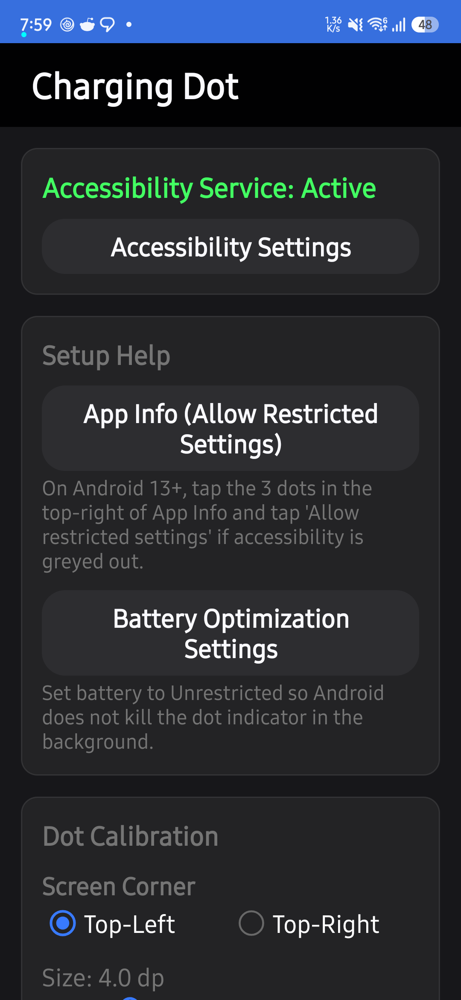
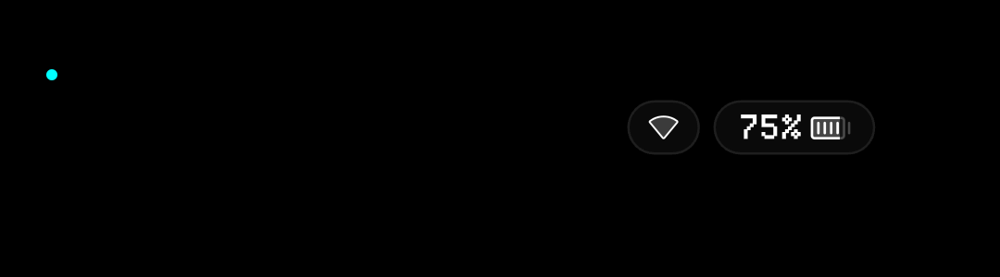

# Charging Dot

Charging Dot is a lightweight Android utility that displays an indicator dot on the screen while the device is charging. It renders an accessibility overlay positioned near the screen corner, changing color based on battery level and charging status. The app uses no background polling, no timers, and requires no network access.

## Screenshots

<p align="center">
  
  &nbsp;&nbsp;&nbsp;&nbsp;
  
</p>
<p align="center">
  
</p>

## Features

- Lightweight overlay rendered through Android's AccessibilityService framework (`TYPE_ACCESSIBILITY_OVERLAY`).
- Event-driven state updates triggered exclusively by system broadcasts (`ACTION_BATTERY_CHANGED` and `ACTION_SCREEN_OFF`). No timers, no polling, and no background wake locks in normal operation.
- Two-state battery threshold indicator: displays a low color below a configurable threshold, and flips to a high color at or above the threshold or when full.
- Battery protection detection: treats `BATTERY_STATUS_NOT_CHARGING` with level >= 80% as full when plugged in (covering Samsung battery protection).
- Calibration controls with live preview: adjust size (3.0 to 8.0 dp), horizontal offset X (0.0 to 80.0 dp), vertical offset Y (0.0 to 80.0 dp), corner selection (top-left or top-right), preset colors, and threshold percentage.
- Optional Fake AOD mode: displays the dot on a fullscreen pure black window when the screen turns off while plugged in.

## Requirements

- Android 8.0 (API level 26) or higher.
- Target SDK 34 (Android 14).
- Verified and tested only on Samsung Galaxy A35 5G running One UI 6 on Android 14.

## Install

1. Download the release APK (`chargingdot-<version>.apk`) and checksum file (`chargingdot-<version>.apk.sha256`) from GitHub Releases.
2. Sideload and install the APK on your device.
3. Open **Charging Dot** from the app launcher.
4. Tap **Enable Accessibility Service** to open the system accessibility settings, locate **Charging Dot Indicator**, and toggle it on.
5. **Android 13+ "Allow restricted settings" step:**
   If the toggle in Accessibility is greyed out with a message stating "Restricted setting":
   *(Note: On Android 13+, the "Allow restricted settings" option in App Info may only appear after you attempt to enable the service once in Accessibility settings.)*
   - Open device **Settings** > **Apps** > **Charging Dot** (or tap **App Info** inside the app).
   - Tap the three-dot menu icon in the upper-right corner.
   - Tap **Allow restricted settings** and confirm your device credential.
   - Return to Accessibility settings and enable the service.
6. **Battery optimization:**
   - Tap **Battery Optimization Settings** in the app (or navigate to App Info > Battery).
   - Set battery usage to **Unrestricted** to prevent the operating system from terminating the service during background execution.

## Verify Your Download

Each release includes an automated `.sha256` checksum file. You can verify the integrity of your downloaded APK before installing:

**On Linux / macOS:**
```bash
sha256sum -c chargingdot-<version>.apk.sha256
```
Or compute the hash manually:
```bash
sha256sum chargingdot-<version>.apk
```

**On Windows (PowerShell):**
```powershell
Get-FileHash chargingdot-<version>.apk -Algorithm SHA256
```

Compare the resulting hash against the contents of `chargingdot-<version>.apk.sha256`.

### Verify Signing Certificate

You can verify that the release APK was signed with the official project key using Android's `apksigner`:

```bash
apksigner verify --print-certs chargingdot-<version>.apk
```

Expected certificate SHA-256 fingerprint:
```
6B:9B:52:8E:C3:11:16:A5:FC:CF:C8:48:45:1D:9C:E2:13:94:90:E8:08:6E:44:5B:E7:8C:F7:33:94:55:6B:9E
```

## Calibrate

1. Open **Charging Dot** to launch the settings screen. While this screen is visible, preview mode activates automatically, displaying the dot even when the device is unplugged.
2. Choose the desired screen corner (Top-Left or Top-Right).
3. Adjust the **Size**, **Horizontal Offset (X)**, and **Vertical Offset (Y)** sliders until the dot aligns with your screen's corner curvature or camera cutout.
4. If the dot is clipped or hidden under a display curve, increase the Horizontal Offset (X) or Vertical Offset (Y).
5. Select preset colors for below and above the battery threshold.
6. Changes apply live without restarting the service. Exiting the app turns off preview mode.

## Fake AOD

Fake AOD is an opt-in feature disabled by default.

When enabled in settings, the app monitors `ACTION_SCREEN_OFF`. If the screen turns off while the device is plugged in, the service launches a fullscreen black activity (`FakeAodActivity`) that holds the screen on while it is showing at a configured brightness level (default 0.60) and draws the dot.

### Caveats

- **Screen remains powered:** Because standard Android does not allow third-party apps to draw on the system Always-On Display, Fake AOD keeps the display hardware turned on.
- **AMOLED burn-in risk:** While the background is `#000000` (turning off pixels on OLED panels), the dot itself remains lit at a static coordinate.
- **Power button behavior:** While plugged in, pressing the hardware power button turns the screen back on to Fake AOD. To turn off the display completely, the device must be unplugged or Fake AOD must be disabled.
- **Dismissal:** Tapping anywhere on the black screen exits Fake AOD.

## Privacy

- **Zero permissions:** The application requests no permissions in `AndroidManifest.xml`. Specifically, `android.permission.INTERNET` is absent.
- Verify with `aapt2 dump permissions <path-to-apk>`:
  ```bash
  aapt2 dump permissions chargingdot-<version>.apk
  ```
  The command prints only the `package:` line; no `uses-permission:` lines appear, confirming no permissions are requested.
- **No data access:** The accessibility service configuration specifies `canRetrieveWindowContent="false"` and completely omits `accessibilityEventTypes` (rather than specifying an empty value). It cannot inspect screen contents, observe user input, or capture keystrokes.
- No analytics, logging backends, or third-party SDKs are included.

## Known Limitations

- **No drawing on system AOD:** The overlay cannot display on the native system Always-On Display or when the display hardware is powered down.
- **Camera/Mic indicator overlap:** The default green color (`#43FF62`) is visually similar to the Android 12+ system privacy dot (microphone/camera indicator). If this creates ambiguity, choose another color preset (e.g., cyan, white, amber, magenta, or red) in settings.
- **Not eligible for Google Play:** Google Play developer policies prohibit apps from using Accessibility services for non-accessibility functions.
- **Hardware variance:** Untested on Android 15 and devices from other manufacturers.

## Build From Source

Prerequisites:
- JDK 17
- Android SDK 34 (`platforms;android-34`, `build-tools;34.0.0`)

Clone and build:
```bash
git clone https://github.com/diluc27/chargingdot.git
cd chargingdot

# Run unit tests
./gradlew testDebugUnitTest

# Run Android Lint
./gradlew lintDebug

# Build debug APK
./gradlew assembleDebug

# Build release APK (falls back to debug signing if release key is not configured)
./gradlew assembleRelease
```

Compiled APKs are output to `app/build/outputs/apk/debug/` and `app/build/outputs/apk/release/`.

## Troubleshooting

- **Dot does not appear when charging:**
  Confirm that `DotAccessibilityService` is enabled in Accessibility settings. Ensure battery optimization is set to Unrestricted.
- **Service toggle is disabled/greyed out:**
  Follow the "Allow restricted settings" instructions under the Install section.
- **Dot position is misaligned:**
  Open the settings screen and adjust the X/Y offset sliders. The preview updates in real time.
- **Fake AOD does not start:**
  Confirm the "Fake AOD" switch is toggled on in settings, and ensure the device is actively plugged into a power source before the screen turns off.

## Contributing

See [CONTRIBUTING.md](CONTRIBUTING.md) for build, testing, and pull request guidelines.

## License

This project is licensed under the MIT License. See [LICENSE](LICENSE) for details.
